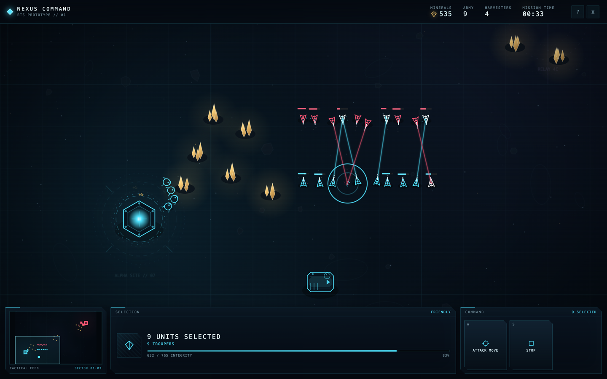
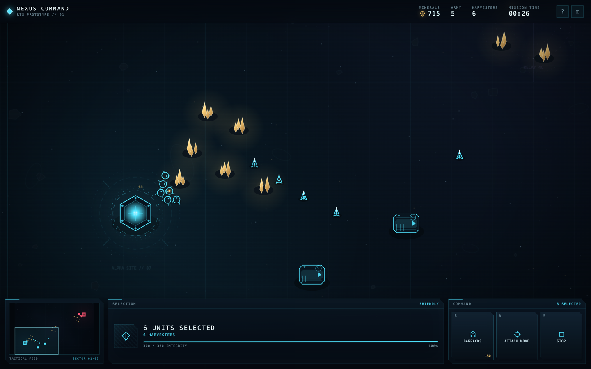
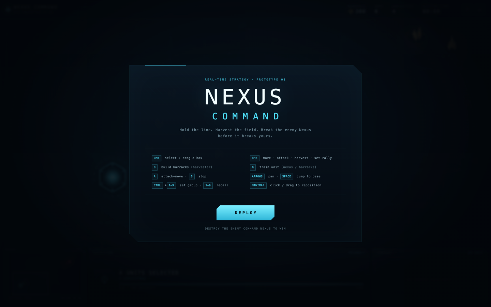

# NEXUS COMMAND

A small, self-contained real-time strategy game prototype inspired by StarCraft. No build step, no dependencies, no game assets — just canvas, HTML, and CSS.

**Status:** playable prototype · **Dependencies:** none

## Screenshots


*First contact on the mineral line.*

| Base economy | Title screen |
| :---: | :---: |
|  |  |

## Run it

Open `index.html` in a browser. That's it.

Or serve the folder locally:

```bash
cd nexus-command
python3 -m http.server 8000
# then open http://localhost:8000
```

## The game

You command a small expeditionary force on a mineral-rich asteroid. Your opponent does the same. Harvest minerals, expand your economy, build an army, and destroy the enemy Command Nexus.

### Features

- **Economy** — harvesters automatically mine mineral fields and return cargo; resources are finite.
- **Base building** — build Barracks with harvesters using a live placement ghost.
- **Two unit types** — Harvester (gathers, fights weakly) and Trooper (ranged infantry).
- **Production queues** — queue up to 3 units per building; rally points send new units where you want them.
- **Combat** — projectiles, damage flashes, health bars, death explosions, auto-acquire when idle, attack-move.
- **Enemy AI** — gathers, expands its worker count, builds one or two barracks, trains waves, reinforces attacks, and defends its base.
- **RTS controls** — drag selection, shift-click, control groups, minimap navigation, camera edge pan, pause.
- **Win / lose** — destroy the enemy Command Nexus, or lose yours.

### Controls

| Input | Action |
| --- | --- |
| `LMB` | Select a unit/building, or drag a selection box |
| `RMB` | Move, attack, harvest, resume construction, or set a building rally |
| `B` | Build Barracks (with harvesters selected) |
| `Q` | Train the selected building's unit |
| `A` | Attack-move targeting mode |
| `S` | Stop selected units |
| `Space` | Center camera on your Nexus |
| Arrow keys / screen edge | Pan camera |
| Middle mouse drag | Pan camera |
| Minimap click / drag | Jump the camera |
| `Ctrl` + `1–9` | Assign control group |
| `1–9` | Recall control group |
| `P` | Pause / resume |
| `H` | Controls overlay |
| `Esc` | Cancel targeting / clear selection |

### Opening build

Your harvesters start selected and already mining.

1. Press `B` and place a **Barracks** near your base.
2. Select your **Command Nexus**, press `Q` a few times to add harvesters (aim for 8).
3. Select the Barracks, press `Q` to train **Troopers**.
4. The first hostile wave launches around 1:20 and arrives shortly after. Keep a few Troopers at home.
5. Build a second Barracks when you can afford it, then push with `A` + left-click and finish the enemy Nexus.

## Project layout

```
nexus-command/
├── index.html   HUD, overlay, canvas
├── style.css    sci-fi interface, responsive layout
├── game.js      simulation, AI, rendering, input, audio-free effects
├── docs/
│   └── screenshots/   README gameplay screenshots
└── README.md
```

## Notes and limitations

This is a proof of concept, not a full RTS:

- 2D canvas graphics with geometric shapes; no sprites or sound.
- One base per side; no fog of war, expansion, or tech tree.
- Movement uses steering and soft collision, not grid pathfinding.
- Combat is intentionally simple: one ranged infantry unit and one worker.
- Balance is tuned for a short 3–8 minute match.

## Debug hook

`window.__NEXUS__` exposes a few read-only getters and helpers for balancing and automated tests:

```js
__NEXUS__.state
__NEXUS__.gameTime
__NEXUS__.minerals         // [player, enemy]
__NEXUS__.entities
__NEXUS__.effects
__NEXUS__.step(5)          // fast-forward 5 simulated seconds
__NEXUS__.freeze()         // pause simulation while keeping the HUD live
__NEXUS__.thaw()
__NEXUS__.select('worker')
__NEXUS__.centerOn(330, 1320)
```
